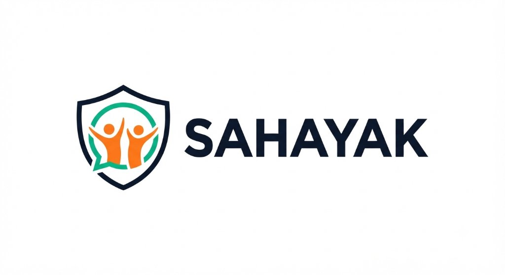
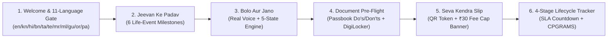

<p align="center">
  
</p>

# SAHAYAK (ಸಹಾಯಕ / सहायक / সহায়ক)

### Sovereign Digital Welfare Discovery, Voice-Guided Eligibility & Anti-Middleman Guidance for Bharat

**Project: PIXEL THEORY** | **PixelCraft 2026 UI/UX Competition** | **Track DS-02: Public Good & Digital Inclusion**

[](https://github.com/vachan18/Sahayak)
[-065F46?style=for-the-badge&logo=vitest)](https://vitest.dev/)
[](https://developer.chrome.com/docs/lighthouse)
[-B45309?style=for-the-badge)](https://github.com/vachan18/Sahayak)
[](https://reactjs.org/)
[](https://supabase.com/)
[](https://github.com/vachan18/Sahayak/actions)

---

## 🎯 Judge's Quick-View (TL;DR)

| Dimension | What SAHAYAK Delivers |
| :--- | :--- |
| **The Problem** | Over **₹4.5 lakh crore** flows through Direct Benefit Transfer (DBT) annually, yet up to **40% of eligible citizens** face exclusion, document rejections, or *dalal* (middleman) overcharging due to English-first jargon and department silos. |
| **The Solution** | A **multilingual, voice-assisted, life-event-first** welfare platform that lets citizens discover schemes, run a deterministic 5-state eligibility check, pre-validate documents, print a fee-capped CSC token slip, and track applications end-to-end. |
| **UI/UX Craft** | **11-language parity** (`en`, `kn`, `hi`, `bn`, `ta`, `te`, `mr`, `ml`, `gu`, `or`, `pa` — 230 keys each), English-first default with `localStorage` persistence, strict single-language UI, **Bright-Sunlight High-Contrast Mode**, `Noto Sans` Indic typography (`1.75x` line-height), and non-overlapping safe-area assistant docking. |
| **Voice & AI** | Real **Web Speech API** (`SpeechRecognition` + live interim transcript) in *Sahayak Sathi* & *Bolo Aur Jano*, 12-scheme grounded responder with 1-tap navigation links, `"Welcome to Sahayak"` entry greeting, and audible phonetic TTS fallback when OS regional voice packs are absent. |
| **Engineering Proof** | **125/125** Vitest tests passing (10 suites), **0** TypeScript errors (`tsc -b`), **100/100** Lighthouse Accessibility, Best Practices & SEO, **92+** Desktop Performance, and 3 automated GitHub Actions workflows. |
| **Kiosk & Cloud Ready** | **Zero-trust Supabase** (PostgreSQL + RLS + SHA-256 idempotency) with automatic **Sovereign Guest / Offline Mode** for rural Gram One & CSC kiosks. |

> **Submission Links:** [GitHub Repository](https://github.com/vachan18/Sahayak) • [Project Board](https://github.com/users/vachan18/projects/4) • [Project Map & Issue Matrix](documentation/SAHAYAK_PROJECT_MAP.md)

---

## 🧭 End-to-End Citizen Experience Flow



---

## ✨ Key UX Innovations & Architectural Pillars

### 1. 🗣 11-Language Sovereign Parity & Real Voice Assistant
- **100% Translation Key Parity across 11 Languages**: **230 verified keys** each across English (`en`), Kannada (`kn`), Hindi (`hi`), Bengali (`bn`), Tamil (`ta`), Telugu (`te`), Marathi (`mr`), Malayalam (`ml`), Gujarati (`gu`), Odia (`or`), and Punjabi (`pa`), with strict single-language UI rendering and `localStorage` preference persistence.
- **Real Speech-to-Text + Voice Integrity**: *Sahayak Sathi* (`useSpeechRecognition.ts`) and *Bolo Aur Jano* use real `SpeechRecognition` with live interim transcripts, mic error recovery, and explicit confirmation, backed by a 12-scheme grounded responder (`assistantResponder.ts`).
- **Audible TTS with Phonetic Fallback**: Native Web Speech synthesis (`*-IN` BCP-47 tags) with `"Welcome to Sahayak"` entry greeting and automatic phonetic fallback when regional OS voice packs are absent.
- **Indic Typography System**: `Noto Sans` font stack across all Indic scripts with `1.75x` line-height to prevent vertical clipping of conjuncts and *matras*.

### 2. ☀️ Outdoor & Accessibility-First Design System (WCAG 2.2 AA & GIGW 3.0)
- **Bright-Sunlight High-Contrast Mode**: Dedicated high-contrast theme engineered for outdoor mobile usage in rural sunlit conditions.
- **Sovereign Color Identity**: Anchored in Sovereign Navy (`#0F172A`) and Warm Saffron (`#F97316`) with semantic status tokens.
- **Motion & Docking Safeguards**: Smooth Framer Motion page transitions respecting `prefers-reduced-motion`, plus safe-area docking so the floating AI/Voice assistant never obscures primary CTAs or bottom navigation.

### 3. 🌱 "Jeevan Ke Padav" — Life-Event Mental Model
Replaces bureaucratic ministry trees with **6 human life milestones**:
- 🌾 **Farming & Agriculture** • 🤱 **Motherhood & Child Care** • 🩺 **Health & Elder Dignity**
- 🎓 **Education & Youth** • 🛠 **Small Business & Artisans** • 🏠 **Housing & Basic Utilities**

### 4. ⚡ "Bolo Aur Jano" — Hardened 5-State Statutory Eligibility Engine
- **Deterministic 5-State Logic**: Enforces strict statutory outcomes instead of misleading "100% guaranteed" claims:
  `not_assessed` ➔ `in_progress` ➔ `potentially_eligible` | `additional_verification_required` | `not_established`
- **Categorized Benefit Breakdown**: Separates **DBT Cash Transfers**, **Health Insurance Cover**, and **Concessional Credit Limits** so totals are never conflated.
- **Statutory Preliminary Guidance Disclaimer**: Clearly states that outputs are preliminary guidance pending official department verification.

### 5. 📄 Visual Document Pre-Flight & Anti-Middleman "Seva Kendra Slip"
- **Passbook Visual Do's & Don'ts**: Side-by-side guidance showing valid front-page scans (IFSC + bank stamp visible) vs. common rejection triggers.
- **DigiLocker Simulation & Optical Pre-Check**: Simulated camera blur check before submission.
- **Treasury-Grade CSC Slip (`/csc-slip`)**: Printable token slip with authentic QR code and mandatory fee protection:
  > *"STATUTORY FEE GUARANTEE: Government Fee is ₹0.00. The maximum authorized convenience fee at an authorized CSC is ₹30.00 only. Do not pay any extra commission."*

### 6. ⏱ 4-Stage Application Lifecycle Tracker & Grievance Redressal
- **Audit-Traceable Stages**: *Submitted ➔ Field Verification ➔ Sanction Order ➔ DBT Credit* with handling officer roles (*e.g., Tahsildar, Revenue Inspector*) and Citizen Charter SLA countdowns.
- **Scheme Comparison & 1-Tap Escalation**: Side-by-side scheme comparison tray and direct CPGRAMS / Sakala grievance guidance.

### 7. 🗄 Zero-Trust Supabase Backend + Sovereign Guest Mode
- **PostgreSQL Relational Schema**: Normalized tables (`profiles`, `schemes`, `assessments`, `assessment_results`, `saved_schemes`, `applications`, household members) with UUID keys and RLS (`auth.uid() = user_id`).
- **SHA-256 Idempotency Hashing**: Tamper-evident assessment audit pipeline (`20261122000006_assessment_idempotency_rpc.sql`).
- **Sovereign Guest Mode**: Automatic offline/guest fallback so citizens at shared rural kiosks can explore schemes and run checks without mandatory sign-up.

---

## 🏛 Verified Statutory Scheme Registry (12 Schemes)

All eligibility rules, exclusions, and benefit figures are validated against Zod schemas and Government of India / State guidelines:

| Scheme Code | Scheme Name | Benefit Category | Core Highlight |
| :--- | :--- | :--- | :--- |
| `pm-kisan` | **PM-KISAN Samman Nidhi** | DBT Cash | ₹6,000 / year (3 × ₹2,000 installments) |
| `pm-jay` | **Ayushman Bharat PM-JAY** | Health Insurance | ₹5,00,000 / family / year hospital cover |
| `pmmvy` | **Pradhan Mantri Matru Vandana Yojana** | DBT Cash | ₹5,000 (1st child) / ₹6,000 (2nd girl child) |
| `pm-svanidhi` | **PM SVANidhi Micro-Credit** | Concessional Credit | ₹10,000 – ₹50,000 working capital + 7% subsidy |
| `post-matric-scholarship` | **Post-Matric Scholarship (SC/ST)** | DBT Cash | Fees + maintenance allowance (income ≤ ₹2.5L) |
| `post-matric-scholarship-minority` | **Post-Matric Scholarship (Minorities)** | DBT Cash | ₹10,000 / year (income ≤ ₹2.0L, ≥ 50% marks) |
| `pm-kcc` | **Kisan Credit Card (KCC)** | Concessional Credit | ₹1,50,000 – ₹3,00,000 credit limit @ 4% |
| `+ 5 more verified schemes` | **Multi-State & Sectoral Schemes** | Mixed | Covered in `src/data/` & `supabase/migrations/` |

---

## 📱 Application Routes (15+ Lazy-Loaded Views)

Defined in [src/routes/AppRoutes.tsx](src/routes/AppRoutes.tsx) with route-level `React.lazy` code splitting:

| Route | Screen | Purpose |
| :--- | :--- | :--- |
| `/welcome`, `/language`, `/onboarding` | **Entry & Dialect Gate** | Bilingual/multilingual greeting, audio preview, 3-step onboarding |
| `/home` | **Sovereign Citizen Dashboard** | Hero voice-search cockpit, seasonal alerts, trust banner, 6 life events |
| `/schemes`, `/schemes/:id` | **Scheme Directory & Detail** | Multi-facet filters (State, Category, Beneficiary), comparison, statutory specs |
| `/eligibility`, `/eligibility/results` | **Bolo Aur Jano** | 5-step voice-guided wizard + 3-tier categorized eligibility results |
| `/documents` | **Document Readiness** | Readiness meter, Passbook Do's/Don'ts modal, DigiLocker simulation |
| `/guidance/:id`, `/csc-slip/:tokenId` | **Guided Filing & CSC Slip** | Self-service e-Sign vs. printable QR Seva Kendra slip with ₹30 fee cap |
| `/tracker`, `/tracker/:id` | **Application Tracker** | 4-stage lifecycle stepper, SLA countdown, CPGRAMS/Sakala escalation |
| `/profile`, `/notifications` | **Household & Alerts** | Multi-member household proxy profiles & DBT milestone notifications |

---

## 🛠 Tech Stack & Performance Metrics

- **Frontend:** React 18.3, TypeScript 5.6 (strict mode), React Router v6 (`BrowserRouter`), Framer Motion 11.15
- **Styling & Icons:** Tailwind CSS 3.4, custom Sovereign Design Tokens, Lucide React
- **State & Validation:** Zustand 5.0, React Hook Form 7.54, Zod 3.24
- **Backend & Auth:** Supabase (`@supabase/supabase-js` 2.119) — PostgreSQL, RLS, Storage (`user-documents`), GoTrue
- **Testing & Build:** Vite 6, Vitest 5.1.1, Testing Library, JSDOM
- **Deployment & CI:** Vercel (`vercel.json` SPA rewrites) + GitHub Actions (`ci.yml`, `lighthouse.yml`, `security-audit.yml`)

### Verified Quality Scorecard

```text
TypeScript Check   : tsc -b                  -> 0 errors (PASS)
Automated Tests    : vitest run              -> 125 / 125 passed across 10 test files (PASS)
Translation Parity : 11 Indian Languages     -> 230 / 230 keys each (100% Parity)
Lighthouse Audit   : Accessibility 100/100 | Best Practices 100/100 | SEO 100/100 | Desktop Perf 92+
```

---

## 🧪 Automated Test Suite (125 Tests / 10 Suites)

```text
 ✓ src/test/schemeSearch.test.ts (5 tests)         — Multilingual search & phonetic tag matching
 ✓ src/test/translations.test.ts (4 tests)         — 11-language (en/kn/hi/bn/ta/te/mr/ml/gu/or/pa) parity
 ✓ src/test/eligibilityEngine.test.ts (49 tests)   — 5-state logic, exclusions & edge cases
 ✓ src/test/schemeValidation.test.ts (5 tests)     — Statutory rule integrity & citations
 ✓ src/test/securityAndPrivacy.test.ts (3 tests)   — Zero PII persistence & client storage safety
 ✓ src/test/store.test.ts (6 tests)                — Zustand household state, language & guest caching
 ✓ src/test/welcomeVoice.test.ts (3 tests)         — Entry voice greeting & phonetic TTS fallback
 ✓ src/test/voiceAssistant.test.ts (3 tests)       — SpeechRecognition STT hook & 12-scheme responder
 ✓ src/test/backendCorrections.test.ts (22 tests)  — Backend hardening, RPC & error resilience
 ✓ src/test/supabaseBackend.test.ts (25 tests)     — Supabase client, Zod schemas, RLS & fallback
```

---

## 🚀 Quick Start & Deployment

### 1. Local Development
```bash
git clone https://github.com/vachan18/Sahayak.git
cd Sahayak
npm install
cp .env.example .env
```
Configure `.env` (optional — leaves guest/offline mode active if omitted):
```dotenv
VITE_SUPABASE_URL=https://your-project.supabase.co
VITE_SUPABASE_ANON_KEY=your-anon-key
VITE_SUPABASE_STORAGE_BUCKET=user-documents
```
Run locally:
```bash
npm run dev      # Start Vite dev server (http://localhost:3000)
npm test         # Run 119 Vitest unit/integration tests
npm run build    # Typecheck (tsc -b) + Vite production build -> dist/
npm run preview  # Preview production build
```

### 2. Supabase 1-Click Schema Setup
1. Open your [Supabase Dashboard](https://supabase.com/dashboard) ➔ **SQL Editor**.
2. Run [`supabase/full_schema_setup.sql`](supabase/full_schema_setup.sql) to provision all tables, RLS policies, idempotency RPCs, storage bucket, and seeded schemes.

### 3. Production Hosting (Vercel + GitHub Actions CI)
- **SPA Routing:** [`vercel.json`](vercel.json) handles `BrowserRouter` rewrites (`/(.*)` ➔ `/index.html`) and immutable asset caching.
- **CI Pipeline:** [`.github/workflows/ci.yml`](.github/workflows/ci.yml) runs `npm ci`, `npm test`, and `npm run build` on every push/PR to `main`.

---

## 📚 Complete Documentation Index

- **[Project Map & Issue Hierarchy Matrix](documentation/SAHAYAK_PROJECT_MAP.md)** — Full Epic/Sub-Issue graph (#1–#24) and commit milestones.
- **Phase 1 (`docs/`):** [Problem Definition](docs/01-problem-definition-and-research.md) • [Personas](docs/02-target-personas-and-pain-points.md) • [Service Blueprint](docs/03-user-journeys-and-service-blueprint.md) • [Objectives](docs/04-product-objectives-and-core-features.md) • [IA](docs/05-information-architecture-and-navigation.md) • [MVP Scope](docs/06-mvp-scope-and-roadmap.md) • [UX Metrics](docs/07-ux-success-criteria-and-metrics.md)
- **Phase 2–3 (`documentation/phase-2/`, `phase-3/`):** Citizen Journeys, 15 Screen Specs, Sovereign Color System, 1.75x Indic Typography, Design Tokens (`design-tokens.json`), GIGW 3.0 / WCAG AA Accessibility.
- **Phase 4–5 (`documentation/phase-4/`, `phase-5/`):** Frontend Architecture, 5-State Eligibility Hardening, Supabase Schema & RLS Security, SHA-256 Idempotency.
- **Phase 6 (`documentation/phase-6.1/` – `phase-6.8/`):** Voice Cockpit, Scheme Catalog, *Bolo Aur Jano*, Passbook Visual Guide, 4-Stage Tracker, High-Contrast Mode, Indic Parity, and Responsive Overflow Audits.

---

**Crafted for PixelCraft 2026 (Track DS-02) by [vachan18](https://github.com/vachan18) and [Muddassir](https://github.com/Muddassir7504)**
