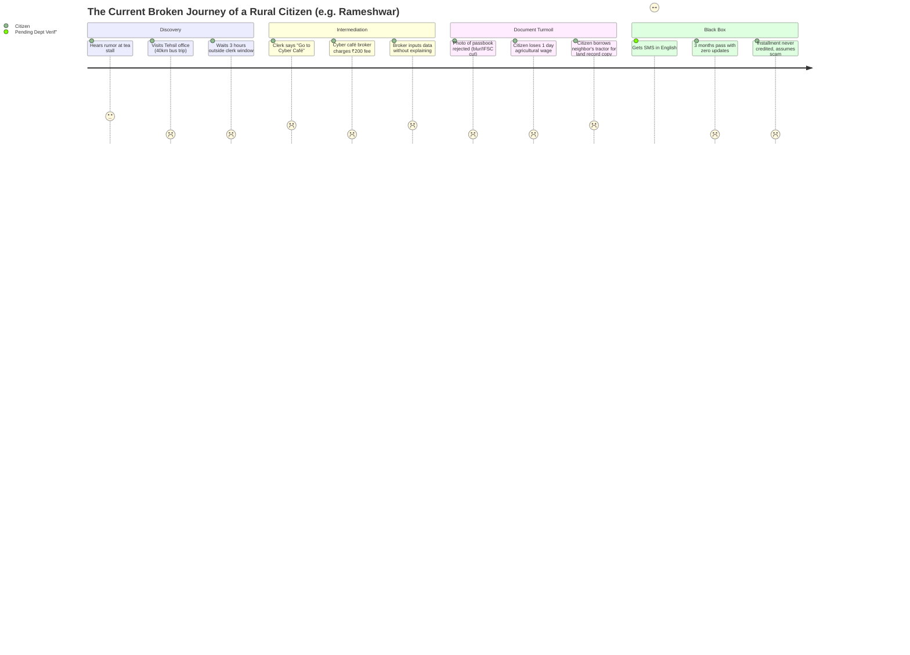
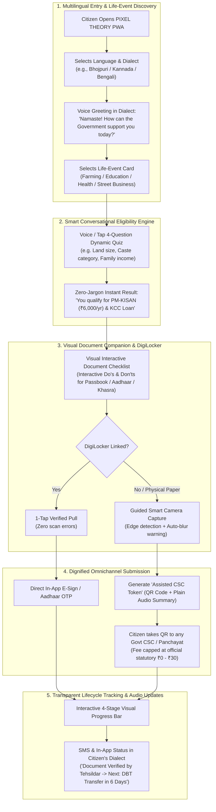

# 03: User Journeys & Omnichannel Service Blueprint

---

## 1. As-Is Journey: The "Bureaucratic Maze" (Today)

The current citizen experience for discovering and applying for a government scheme is characterized by high friction, financial loss, emotional exhaustion, and frequent abandonment.



### Critical Breakpoints in the As-Is Journey:
1. **Breakpoint 1 (Cognitive Blindness)**: The citizen does not know what schemes exist for their specific demographic context.
2. **Breakpoint 2 (Exploitative Gateway)**: Because official portals are hostile, the citizen is forced into the hands of unregulated local brokers who extract bribes/fees.
3. **Breakpoint 3 (The Document Bounce)**: 30%+ of applications bounce because citizen uploads a passbook without a visible bank stamp or an expired caste certificate.
4. **Breakpoint 4 (Silent Rejection)**: When an application is flagged for deficiency, the system sends an obscure English text message; the citizen has no idea how to cure the defect within the 15-day rectification window.

---

## 2. To-Be Journey: The PIXEL THEORY Experience

PIXEL THEORY reimagines this journey as an empowering, audio-visual, vernacular dialog that guides the citizen from curiosity to confirmed bank credit.



---

## 3. Omnichannel Service Blueprint

The table below maps the frontstage citizen experience directly to backstage digital public infrastructure (India Stack, Bhashini, DigiLocker, state e-District databases).

```
+-------------------------------------------------------------------------------------------------------------------------+
| Layer                  | Phase 1: Discover           | Phase 2: Verify        | Phase 3: Prepare        | Phase 4: Track        |
+-------------------------------------------------------------------------------------------------------------------------+
| Physical / Touchpoint  | Mobile Web / PWA / CSC     | Interactive Voice /    | Physical Documents /    | SMS / WhatsApp Audio /|
|                        | Kiosk Display               | Vernacular Cards       | DigiLocker Storage      | Gram Panchayat Notice |
+-------------------------------------------------------------------------------------------------------------------------+
| Citizen Actions        | Listens to dialect greeting;| Answers 3-4 voice/tap  | Snaps photo of papers   | Plays audio message   |
| (Frontstage)           | picks life event card       | questions in dialect   | or connects DigiLocker  | to hear next step     |
+-------------------------------------------------------------------------------------------------------------------------+
| System UI Responses    | Audio prompt playback;      | Real-time scheme match;| Side-by-side visual     | Color-coded milestone |
|                        | dynamic font rendering      | entitlement value card | checklist & crop guide  | timeline with SLA     |
+-------------------------------------------------------------------------------------------------------------------------+
| Backstage Services &   | Bhashini ASR/TTS Engine;    | myScheme Rules Engine; | DigiLocker REST API;    | PFMS / DBT Bharat API;|
| Integrations           | Language dialect CDN;       | State Welfare Database | Tesseract/OCR engine    | State e-District API; |
|                        | Geo-IP state detector       | for quota matching     | for name/IFSC match     | SMS gateway (CDAC)    |
+-------------------------------------------------------------------------------------------------------------------------+
| Support & Governance   | Local dialect corpus        | Scheme gazette updates | CSC operator guidelines;| Grievance officer     |
| Processes              | curation; Bhashini training | maintained by NeGD/NIC | statutory fee charter   | 15-day SLA escalation |
+-------------------------------------------------------------------------------------------------------------------------+
```
