# SAHAYAK — Comprehensive Project Map & Implementation Matrix

> **Repository**: [https://github.com/vachan18/Sahayak](https://github.com/vachan18/Sahayak)  
> **GitHub Project Board**: [https://github.com/users/vachan18/projects/4](https://github.com/users/vachan18/projects/4)  
> **Repository Projects Tab**: [https://github.com/vachan18/Sahayak/projects](https://github.com/vachan18/Sahayak/projects)  
> **Competition Track**: PixelCraft 2026 (Track DS-02: Public Good & Digital Inclusion)  
> **Verification Status**: 24/24 Tickets Closed (`Completed`) • 119/119 Vitest Tests Passing • 0 TypeScript Errors • 100/100 Lighthouse A11y/Best-Practices/SEO

---

## 🗺️ High-Level Project Architecture Map

```mermaid
graph TD
    classDef epic fill:#0F172A,stroke:#F97316,stroke-width:2px,color:#FFFFFF;
    classDef issue fill:#F8FAFC,stroke:#0F172A,stroke-width:1px,color:#0F172A;

    E1["EPIC #1: Information Architecture & Design Tokens"]:::epic
    E2["EPIC #4: Frontend Core & 5-State Eligibility Engine"]:::epic
    E3["EPIC #9: Supabase Backend & Idempotent Audits"]:::epic
    E4["EPIC #13: Citizen Dashboard & Scheme Discovery"]:::epic
    E5["EPIC #17: Bolo Aur Jano & Assisted Ops"]:::epic
    E6["EPIC #21: Motion, High-Contrast & Lighthouse"]:::epic

    E1 --> I2["#2 Phase 2: Citizen Journeys & IA"]:::issue
    E1 --> I3["#3 Phase 3: Sovereign Design Tokens"]:::issue

    E2 --> I5["#5 Phase 4.1-4.3: Responsive 1400px Shell"]:::issue
    E2 --> I6["#6 Phase 4.4: Strict TS & Vitest Suite"]:::issue
    E2 --> I7["#7 Phase 4.5: Benefit Models & Zod"]:::issue
    E2 --> I8["#8 Phase 4.6: 5-State Statutory Rules Engine"]:::issue

    E3 --> I10["#10 Phase 5.0: Supabase PostgreSQL Schema"]:::issue
    E3 --> I11["#11 Phase 5.1: RLS & Household Members"]:::issue
    E3 --> I12["#12 Phase 5.2: SHA-256 Idempotency Hashing"]:::issue

    E4 --> I14["#14 Phase 6.1: Voice Cockpit & Life Events"]:::issue
    E4 --> I15["#15 Phase 6.2: Seasonal Alerts & Trust Banner"]:::issue
    E4 --> I16["#16 Phase 6.3: Scheme Catalog & Filtering"]:::issue

    E5 --> I18["#18 Phase 6.4: Bolo Aur Jano Voice Flow"]:::issue
    E5 --> I19["#19 Phase 6.5: Document Prep & CSC Slip"]:::issue
    E5 --> I20["#20 Phase 6.6: 4-Stage Application Tracker"]:::issue

    E6 --> I22["#22 Phase 6.7: Framer Motion & Contrast Mode"]:::issue
    E6 --> I23["#23 Phase 6.8: Assistant Safeguards & Key Parity"]:::issue
    E6 --> I24["#24 Lighthouse: 100/100 A11y & Performance"]:::issue
```



---

## 🏛️ Epics and Sub-Issue Breakdown

### Epic 1: Information Architecture & Sovereign Design Tokens
- **Parent Issue**: [#1 [EPIC] Phase 2 & 3: Information Architecture, Sovereign Design Tokens & Visual Identity](https://github.com/vachan18/Sahayak/issues/1) — `CLOSED`
- **Sub-Issues**:
  - [#2 Phase 2 — Information Architecture, Citizen Journey Maps & Vernacular Navigation Flow](https://github.com/vachan18/Sahayak/issues/2) — `CLOSED`
  - [#3 Phase 3 — Design Tokens, Indic Typography Scale & Sovereign Color System](https://github.com/vachan18/Sahayak/issues/3) — `CLOSED`
- **Deliverables**: Comprehensive sitemap, persona maps (Ramesh, Sunita, Rajesh), tri-tier design tokens, Indic typography scales (Kannada, Devanagari, Bengali, Inter), Sovereign Navy (`#0F172A`) & Warm Saffron (`#F97316`) identity.
- **Documentation**: `documentation/phase-2/`, `documentation/phase-3/`

---

### Epic 2: Frontend Core, 5-State Eligibility Engine & Statutory Data Integrity
- **Parent Issue**: [#4 [EPIC] Phase 4: Frontend Core, 5-State Eligibility Engine & Statutory Data Integrity](https://github.com/vachan18/Sahayak/issues/4) — `CLOSED`
- **Sub-Issues**:
  - [#5 Phase 4.1 - 4.3 — Responsive Desktop Shell (1400px), Navigation Bar & Trust Audit](https://github.com/vachan18/Sahayak/issues/5) — `CLOSED`
  - [#6 Phase 4.4 — Codebase Audit, Strict TypeScript Verification & Vitest Test Runner](https://github.com/vachan18/Sahayak/issues/6) — `CLOSED`
  - [#7 Phase 4.5 — Categorized Benefit Model, Statutory Data Integrity & Zod Schemas](https://github.com/vachan18/Sahayak/issues/7) — `CLOSED`
  - [#8 Phase 4.6 & 4.6.1 — 5-State Eligibility Engine Hardening & Vitest Regression Suite](https://github.com/vachan18/Sahayak/issues/8) — `CLOSED`
- **Deliverables**: 1400px desktop grid container, removal of universal marketing claims, strict TypeScript compilation with 0 errors, Zod runtime schemas, 5-state deterministic eligibility engine, 12 verified government schemes with statutory rules.
- **Commits**: `39b13fa`, `81e3725`, `6cba92a`, `17a1bdd`, `96d871f`, `47541d4`, `bc07f68`
- **Documentation**: `documentation/phase-4/` to `phase-4.6.1/`

---

### Epic 3: Supabase Cloud Backend, Row-Level Security & Idempotent Audit Pipeline
- **Parent Issue**: [#9 [EPIC] Phase 5: Supabase Cloud Backend, Row-Level Security & Idempotent Audit Pipeline](https://github.com/vachan18/Sahayak/issues/9) — `CLOSED`
- **Sub-Issues**:
  - [#10 Phase 5.0 — Supabase PostgreSQL Schema Integration & Offline/Guest Mode Fallback](https://github.com/vachan18/Sahayak/issues/10) — `CLOSED`
  - [#11 Phase 5.1 — Database Security Grants, RLS Policies, Deduplication & Household Members](https://github.com/vachan18/Sahayak/issues/11) — `CLOSED`
  - [#12 Phase 5.2 — SHA-256 Idempotency Hashing & Automated Migration Verification](https://github.com/vachan18/Sahayak/issues/12) — `CLOSED`
- **Deliverables**: Relational PostgreSQL schema (`full_schema_setup.sql`), fine-grained Row-Level Security (RLS) policies, household member management, SHA-256 idempotency hashing for tamper-evident audit logs, automatic offline/guest fallback.
- **Commits**: `8b181c3`, `b8a7374`, `b57ebf4`, `8d99387`, `3d58a8c`, `cd265fe`
- **Documentation**: `documentation/phase-5/`, `documentation/phase-5.1/`, `documentation/phase-5.2/`

---

### Epic 4: Sovereign Citizen Dashboard & Scheme Discovery Experience
- **Parent Issue**: [#13 [EPIC] Phase 6.1 – 6.3: Sovereign Citizen Dashboard & Scheme Discovery Experience](https://github.com/vachan18/Sahayak/issues/13) — `CLOSED`
- **Sub-Issues**:
  - [#14 Phase 6.1 — Sovereign Citizen Dashboard, Hero Voice-Search Cockpit & Life-Event Grid](https://github.com/vachan18/Sahayak/issues/14) — `CLOSED`
  - [#15 Phase 6.2 — Seasonal Welfare Alerts, Statutory Trust Banner & Multi-State Citizen Personalization](https://github.com/vachan18/Sahayak/issues/15) — `CLOSED`
  - [#16 Phase 6.3 — Scheme Directory, Multi-Facet Filters & Comprehensive Scheme Detail Pages](https://github.com/vachan18/Sahayak/issues/16) — `CLOSED`
- **Deliverables**: High-impact Hero Voice-Search Cockpit, life-event navigation grid (Farming, Education, Health, Senior Living, Housing), seasonal welfare alerts, official statutory trust banner, multi-faceted filtering (State, Beneficiary, Category), deep scheme detail views with official portal links.
- **Commit**: `67c5394`
- **Documentation**: `documentation/phase-6.1/`, `phase-6.2/`, `phase-6.3/`

---

### Epic 5: Bolo Aur Jano Conversational Voice, Document Ops & Application Tracking
- **Parent Issue**: [#17 [EPIC] Phase 6.4 – 6.6: Bolo Aur Jano Conversational Voice, Document Ops & Application Tracking](https://github.com/vachan18/Sahayak/issues/17) — `CLOSED`
- **Sub-Issues**:
  - [#18 Phase 6.4 — Bolo Aur Jano: Voice-Guided Conversational Eligibility Flow & 3-Tier Results](https://github.com/vachan18/Sahayak/issues/18) — `CLOSED`
  - [#19 Phase 6.5 — Document Preparation Checklist, Passbook Visual Guide & Printable CSC Slip](https://github.com/vachan18/Sahayak/issues/19) — `CLOSED`
  - [#20 Phase 6.6 — Four-Stage Application Lifecycle Tracker, Scheme Comparison & Grievance Redressal](https://github.com/vachan18/Sahayak/issues/20) — `CLOSED`
- **Deliverables**: One-question-at-a-time conversational questionnaire, genuine Web Speech API with transcript confirmation, 3-tier clear result breakdown, document readiness checklist with bank passbook Do's & Don'ts, DigiLocker simulation, printable CSC Seva Kendra slips with authentic QR, 4-stage visual tracker, side-by-side comparison tray, and grievance redressal (CPGRAMS / Sakala).
- **Commit**: `67c5394`
- **Documentation**: `documentation/phase-6.4/`, `phase-6.5/`, `phase-6.6/`

---

### Epic 6: Motion System, High-Contrast, Indic Parity & Lighthouse Optimization
- **Parent Issue**: [#21 [EPIC] Phase 6.7, 6.8 & Lighthouse: Motion System, High-Contrast, Indic Parity & 100/100 Audit](https://github.com/vachan18/Sahayak/issues/21) — `CLOSED`
- **Sub-Issues**:
  - [#22 Phase 6.7 — Framer Motion Polish, Bright-Sunlight High-Contrast Mode & Indic Parity](https://github.com/vachan18/Sahayak/issues/22) — `CLOSED`
  - [#23 Phase 6.8 — Floating Assistant Non-Overlap Safeguards, Speech Integrity & Zero-Hardcoded Strings](https://github.com/vachan18/Sahayak/issues/23) — `CLOSED`
  - [#24 Lighthouse Optimization — 100/100 Accessibility, Best Practices, SEO & 92+ Desktop Performance](https://github.com/vachan18/Sahayak/issues/24) — `CLOSED`
- **Deliverables**: Fluid Framer Motion transitions with `prefers-reduced-motion` compliance, outdoor bright-sunlight high-contrast mode, non-overlapping floating voice assistant with safe-area docking, 100% translation key parity across 4 Indic languages (413 keys each), dynamic code splitting reducing bundle size to 168 kB, async Google fonts loading, and perfect Lighthouse scores.
- **Commits**: `67c5394`, `f31f7ab`, `724b5dc`
- **Documentation**: `documentation/phase-6.7/`, `phase-6.8/`, `documentation/lighthouse/`

---

## 📊 Summary of Repository Pushes & Milestones

| Commit | Scope / Phase | Primary Milestone Description |
|---|---|---|
| `af18d5d` | Initial Release | Base SAHAYAK portal release for PixelCraft 2026 (Track DS-02) |
| `39b13fa` | Phase 4.1 | UI polish, UX trust audit, and 5-state eligibility engine baseline |
| `81e3725` | Phase 4.2 | Desktop responsive redesign, 1400px container, and top navigation header |
| `6cba92a` | Phase 4.3 | Responsive container layout hardening and universal claims removal |
| `17a1bdd` | Phase 4.4 | Strict TypeScript audit (`tsc -b`), modularization, and Vitest suite |
| `96d871f` | Phase 4.5 | Categorized benefit model (Cash, In-Kind, Insurance) & Zod validation |
| `47541d4` | Phase 4.6 | Statutory eligibility rules registry with 12 verified government schemes |
| `bc07f68` | Phase 4.6.1 | Eligibility edge case hardening, statutory alignment, and Vitest suite |
| `8b181c3` | Phase 5.0 | Supabase backend integration, PostgreSQL schema, and offline guest mode |
| `b8a7374` | Phase 5.0 | Unified `full_schema_setup.sql` for 1-click Supabase Dashboard migration |
| `3d58a8c` | Phase 5.1 | RLS security policies, grants, deduplication, and household members |
| `cd265fe` | Phase 5.2 | SHA-256 idempotency hashing, live env verification, and deployment docs |
| `67c5394` | Phase 6.1 – 6.7 | Dashboard cockpit, scheme directory, voice checker, document ops, tracker |
| `f31f7ab` | Phase 6.8 | Voice assistant safeguards, manual speech confirmation, Indic parity |
| `724b5dc` | Lighthouse | 100/100 Accessibility, 100/100 Best Practices, 100/100 SEO, 92+ Performance |

---

## 🧪 Technical Verification Metrics

```text
TypeScript Compilation:  tsc -b --noEmit -> 0 errors (PASS)
Unit & Regression Tests: 119 / 119 passing across 8 test suites (PASS)
Translation Key Parity:  en: 413, kn: 413, hi: 413, bn: 413 (100% PARITY)
Initial JS Bundle Size:  168 kB (via dynamic React.lazy code splitting)
Lighthouse Accessibility: 100 / 100
Lighthouse Best Practices: 100 / 100
Lighthouse SEO:           100 / 100
Lighthouse Desktop Perf:  92+ / 100
```
