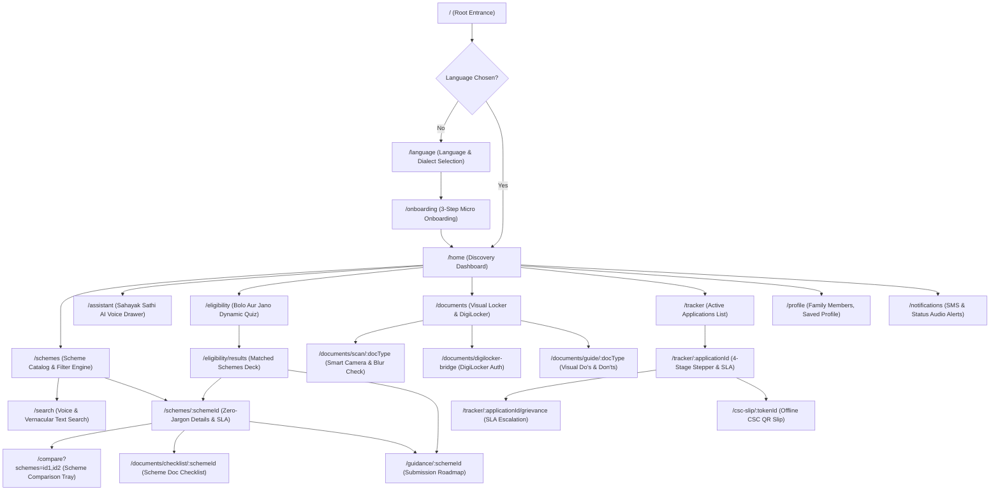

# SAHAYAK (सहायक / ಸಹಾಯಕ)
## Application Sitemap & Route Hierarchy
### Project: PIXEL THEORY | Track DS-02 | Phase 2 Deliverable

---

## 1. Visual Sitemap (Mermaid)



---

## 2. Route Directory & Endpoint Mapping

```
+-------------------------------------------------------------------------------------------------------------------------+
| URL Path                     | Screen / Modal Name               | Query / Route Parameters    | Purpose                |
+-------------------------------------------------------------------------------------------------------------------------+
| /                            | Root Route / Splash              | None                        | Checks local storage   |
|                              |                                   |                             | for language token     |
+-------------------------------------------------------------------------------------------------------------------------+
| /language                    | Language & Dialect Selection      | ?returnUrl=/schemes         | Select Kannada, Hindi, |
|                              |                                   |                             | English + voice check  |
+-------------------------------------------------------------------------------------------------------------------------+
| /onboarding                  | 3-Step Micro Onboarding           | None                        | Visual/audio guide of  |
|                              |                                   |                             | SAHAYAK features       |
+-------------------------------------------------------------------------------------------------------------------------+
| /home                        | Discovery Dashboard               | None                        | Life-event grid, urgent|
|                              |                                   |                             | alerts, voice trigger  |
+-------------------------------------------------------------------------------------------------------------------------+
| /schemes                     | Scheme Discovery Catalog          | ?category=farming&sort=payout| Sector browsing, filter|
|                              |                                   |                             | drawer, search bar     |
+-------------------------------------------------------------------------------------------------------------------------+
| /schemes/:schemeId           | Scheme Details & Benefits         | :schemeId (e.g. pm-kisan)   | Plain-language specs,  |
|                              |                                   |                             | benefits, SLA, costs   |
+-------------------------------------------------------------------------------------------------------------------------+
| /compare                     | Scheme Comparison Tray            | ?ids=pm-kisan,kcc-loan      | Side-by-side comparison|
+-------------------------------------------------------------------------------------------------------------------------+
| /eligibility                 | "Bolo Aur Jano" Quiz              | ?step=1&flow=quick          | Dynamic 3-5 question   |
|                              |                                   |                             | voice/tap wizard       |
+-------------------------------------------------------------------------------------------------------------------------+
| /eligibility/results         | Eligibility Results Deck          | ?session=xyz                | Qualified schemes,     |
|                              |                                   |                             | partial matches        |
+-------------------------------------------------------------------------------------------------------------------------+
| /documents                   | Document Locker Hub               | None                        | Saved docs, DigiLocker |
|                              |                                   |                             | status, missing alert  |
+-------------------------------------------------------------------------------------------------------------------------+
| /documents/checklist/:schemeId| Scheme Document Checklist        | :schemeId                   | Mandatory vs optional  |
|                              |                                   |                             | papers for scheme      |
+-------------------------------------------------------------------------------------------------------------------------+
| /documents/guide/:docType    | Visual Do's & Don'ts Guide        | :docType (e.g. passbook)    | Interactive visual of  |
|                              |                                   |                             | correct vs wrong scan  |
+-------------------------------------------------------------------------------------------------------------------------+
| /documents/scan/:docType     | Smart Camera Scanner              | :docType                    | On-device blur check   |
|                              |                                   |                             | & edge auto-crop       |
+-------------------------------------------------------------------------------------------------------------------------+
| /guidance/:schemeId          | Application Submission Roadmap    | :schemeId                   | Self eSign vs Assisted |
|                              |                                   |                             | CSC Token option       |
+-------------------------------------------------------------------------------------------------------------------------+
| /csc-slip/:tokenId           | Assisted CSC Token Slip           | :tokenId                    | QR code, doc checklist,|
|                              |                                   |                             | max ₹30 fee warning    |
+-------------------------------------------------------------------------------------------------------------------------+
| /tracker                     | Application Tracker Hub           | None                        | All active & past      |
|                              |                                   |                             | scheme tokens          |
+-------------------------------------------------------------------------------------------------------------------------+
| /tracker/:applicationId      | Application Milestone Tracker     | :applicationId              | 4-Stage visual timeline|
|                              |                                   |                             | with spoken audio note |
+-------------------------------------------------------------------------------------------------------------------------+
| /tracker/:appId/grievance    | CPGRAMS Grievance Escalation      | :appId                      | Direct breach report   |
+-------------------------------------------------------------------------------------------------------------------------+
| /assistant                   | "Sahayak Sathi" Voice Assistant   | Modal / Persistent Drawer   | Conversational audio AI|
|                              |                                   |                             | helper in Kannada/Hindi|
+-------------------------------------------------------------------------------------------------------------------------+
| /profile                     | User & Family Proxy Profile       | None                        | Switch member, age,    |
|                              |                                   |                             | land size, caste cat.  |
+-------------------------------------------------------------------------------------------------------------------------+
| /notifications               | Notification & Voice Alerts Center| None                        | Scheme alerts, urgent  |
|                              |                                   |                             | milestone SMS audios   |
+-------------------------------------------------------------------------------------------------------------------------+
```

---

## 3. Modal Views, Drawers & System Overlays

1. **Language & Dialect Switcher Overlay (`#modal-lang-switch`)**:
   - Accessible from top navigation bar at all times.
   - Allows changing between Kannada, Hindi, and English with instant voice preview.
2. **"Sahayak Sathi" AI Voice Assistant Drawer (`#drawer-ai-voice`)**:
   - Bottom sheet drawer with animated audio waveform, microphone toggle, and real-time vernacular transcript.
3. **Filter & Sort Bottom Sheet (`#drawer-filters`)**:
   - Allows filtering schemes by: Life Stage, Benefit Type (Cash/Loan/Insurance), Maximum Processing Time (<7 days, <15 days), and Gender/Social category.
4. **Document Preview & Inspection Modal (`#modal-doc-preview`)**:
   - Shows high-resolution view of verified document with green verified checkmark or amber "blur detected" notice.
5. **Offline & Low-Bandwidth Network Toast (`#toast-offline`)**:
   - Informs citizen that SAHAYAK is operating from local cache and cached audio recordings are available offline.
