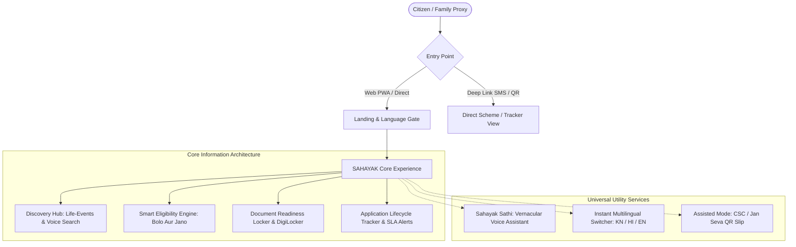

# SAHAYAK (सहायक / ಸಹಾಯಕ)
## Product Information Architecture & System Hierarchy
### Project: PIXEL THEORY | Track DS-02 | Phase 2 Deliverable

---

## 1. Architectural Philosophy & Mental Models

SAHAYAK is designed for **Bharat First**: citizens navigating public entitlements in their regional languages (Kannada, Hindi, English and expanding pan-India). The architecture departs completely from traditional e-governance portals that mirror ministerial silos (e.g., *Ministry of Agriculture*, *Department of Social Justice*).

### Core Mental Model: The Citizen Life-Event Continuum
Instead of forcing citizens to decipher government administrative structures, SAHAYAK organizes all entitlements around universal life milestones and immediate human needs:
1. **Livelihood & Agriculture** (ಬೆಳೆ ಮತ್ತು ಜೀವನೋಪಾಯ / खेती और आजीविका)
2. **Motherhood & Child Wellbeing** (ತಾಯಿ ಮತ್ತು ಮಗು / मातृत्व एवं शिशु कल्याण)
3. **Health & Elder Care** (ಆರೋಗ್ಯ ಮತ್ತು ವೃದ್ಧಾಪ್ಯ / स्वास्थ्य एवं वरिष्ठ नागरिक)
4. **Youth, Education & Skills** (ಶಿಕ್ಷಣ ಮತ್ತು ಯುವಜನತೆ / शिक्षा एवं युवा)
5. **Micro-enterprise & Artisan Credit** (ಸಣ್ಣ ವ್ಯಾಪಾರ / लघु व्यवसाय एवं कारीगर)
6. **Shelter & Essential Utilities** (ವಸತಿ ಮತ್ತು ಮೂಲಸೌಕರ್ಯ / आवास एवं बुनियादी सुविधाएं)



---

## 2. Domain Entity Relationships & Content Model

The information architecture rests on eight decoupled, highly structured entities:

```
+---------------------------------------------------------------------------------------------------------+
| Entity                  | Key Attributes                                 | Relationships                |
+---------------------------------------------------------------------------------------------------------+
| 1. Citizen Profile      | ID, preferredLanguage, preferredDialect,       | Has one EligibilityState;    |
|    (Anonymous/Stored)   | ageGroup, gender, socialCategory (Gen/OBC/SC/ST)| Has many Applications;       |
|                         | occupation, landholdingSize, annualIncomeRange | Has many SavedDocuments      |
+---------------------------------------------------------------------------------------------------------+
| 2. Life Event           | eventId, title (KN/HI/EN), iconGlyph,          | Groups many Schemes;         |
|                         | urgencyTag, description                        | Triggers targeted Quiz       |
+---------------------------------------------------------------------------------------------------------+
| 3. Scheme Record        | schemeId, officialName, vernacularName,        | Belongs to Ministry/Dept;    |
| (Strictly Verified)     | benefitType (Cash/DBT, Loan, In-Kind),         | Requires EligibilityRuleSet; |
|                         | financialValue (e.g. ₹6000/yr), statutoryFee,  | Requires DocumentChecklist;  |
|                         | processingSLA (Days), officialGrievanceOfficer | Has many ApplicationInstances|
+---------------------------------------------------------------------------------------------------------+
| 4. Eligibility RuleSet  | ruleId, criteriaMatrix (Occupation, Income,    | Evaluated by Eligibility     |
|                         | Land, Category, Age, Gender), mandatoryFlags   | Engine against Profile       |
+---------------------------------------------------------------------------------------------------------+
| 5. Document Spec        | docId, canonicalName, vernacularName,          | Linked to DigiLocker Issuer; |
|                         | sampleImageUrl (Do/Don't), acceptableFormats,  | Pre-checked by Smart Scanner |
|                         | validityPeriodYears, issuingAuthority          |                              |
+---------------------------------------------------------------------------------------------------------+
| 6. Application Instance | applicationId, tokenNumber, schemeId,          | Belongs to Citizen Profile;  |
|                         | submissionMode (Self/Assisted CSC),            | Has a 4-Stage MilestoneLog;  |
|                         | status (Submitted/Verifying/Sanctioned/DBT),   | Has SLA Expiry Date          |
|                         | handlingOfficer, grievanceFlag                 |                              |
+---------------------------------------------------------------------------------------------------------+
| 7. Milestone Log        | milestoneId, stage (1-4), timestamp,           | Belongs to Application;      |
|                         | officerRemarks, audioNarrationUrl (KN/HI/EN)   | Triggers Push/SMS Alert      |
+---------------------------------------------------------------------------------------------------------+
| 8. Assisted QR Token    | tokenId, encryptedPayload (Verified Docs &     | Printable / Shareable;       |
|                         | Eligibility Snapshot), statutoryMaxCharge (₹30)| Decodable by CSC VLE Operator|
+---------------------------------------------------------------------------------------------------------+
```

---

## 3. User Roles, Personas & Permission Matrix

SAHAYAK serves three distinct user roles with tailored permission models:

```
+--------------------------------------------------------------------------------------------------------------------+
| Role                   | Primary Actor              | Permissions & Capabilities                                   |
+--------------------------------------------------------------------------------------------------------------------+
| 1. Direct Citizen      | Semi-literate or rural     | - Browse all schemes in Kannada, Hindi, English              |
|    (Self-Service)      | beneficiary (e.g., Ramesh, | - Voice-first eligibility check without login                |
|                        | Lakshmi)                   | - Upload document photos with local blur pre-check           |
|                        |                            | - Connect personal DigiLocker via OTP                        |
|                        |                            | - Generate offline Assisted CSC QR token                     |
|                        |                            | - Track application status with spoken audio summaries       |
+--------------------------------------------------------------------------------------------------------------------+
| 2. Digital Proxy /     | Tech-savvy child or        | - All Citizen permissions PLUS:                              |
|    Family Helper       | student (e.g., Sunita)     | - Manage multiple profiles under one account (Father, Mother)|
|                        |                            | - Direct online e-Sign and document uploading               |
|                        |                            | - Download official sanction letters and PDF dossiers        |
|                        |                            | - Direct CPGRAMS / CM Helpline 1-tap grievance filing        |
+--------------------------------------------------------------------------------------------------------------------+
| 3. Assisted Operator   | Common Service Centre      | - Scan citizen's SAHAYAK QR Token                           |
|    (VLE / Village Aide)| (CSC) operator / Gram      | - Instant pre-filled bulk view of verified documents         |
|                        | Panchayat Mitra            | - Clear display of mandatory maximum statutory fee (₹0 - ₹30)|
|                        |                            | - Read-only access to citizen dossier with citizen's consent |
+--------------------------------------------------------------------------------------------------------------------+
| 4. Anonymous Explorer  | First-time visitor         | - Full access to discovery, search, eligibility quizzes      |
|                        | (No login required)        | - No personal data collected until user chooses to save      |
+--------------------------------------------------------------------------------------------------------------------+
```

---

## 4. Screen Hierarchy & Navigation Depth

SAHAYAK strictly limits depth to **maximum 2 levels** from the home screen to prevent navigational disorientation among low-digital-literacy users:

```
[Level 0: Global Navigation / Persistent Frame]
  ├── Top Bar: [Language Switcher (KN/HI/EN)] • [Audio Voiceover Toggle] • [Accessibility A+/A-]
  └── Bottom Navigation (4 Core Tabs):
        ├── Tab 1: Discovery (ಮುಖಪುಟ / खोजें)
        ├── Tab 2: Eligibility Checker (ಅರ್ಹತೆ / पात्रता)
        ├── Tab 3: Document Locker (ದಾಖಲೆಗಳು / दस्तावेज़)
        └── Tab 4: Application Tracker (ಸ್ಥಿತಿ / स्थिति)

[Level 1: Primary Screen Views]
  ├── /home (Life-Event Grid, Urgent Seasonal Schemes, Voice Search Trigger)
  ├── /schemes (Filterable List by Sector, Benefit Type, Cash Amount)
  ├── /eligibility (Bolo Aur Jano Dynamic Conversational Flow)
  ├── /documents (Visual Do's/Don'ts Library, DigiLocker Sync)
  ├── /tracker (Active Token List, Milestone Status)
  └── /assistant (Sahayak Sathi Conversational Voice Modal)

[Level 2: Detail, Action & Result Overlays]
  ├── /schemes/:schemeId (Zero-Jargon Details, Benefits, SLA, Grievance Info)
  ├── /eligibility/results (Matched Schemes Deck, Partial Matches, Fallbacks)
  ├── /documents/:docId/verify (Smart Camera Scan, Edge Detection, Optical Check)
  ├── /guidance/:schemeId (Step-by-Step Submission Roadmap: Self eSign vs CSC QR)
  ├── /tracker/:applicationId (Detailed 4-Stage Milestone History + Audio Brief)
  └── /csc-slip/:tokenId (Printable/Scannable Offline Token with Statutory Fee Banner)
```

---

## 5. User Entry & Exit Points

### Critical Entry Points
1. **PWA Direct Launch / Home Screen Icon**: Returns to last selected language with cached offline state.
2. **Deep-Link SMS Notification**: E.g., `sahayak.gov.in/t/84920` opens directly into the localized Application Tracker for application #84920 with instant audio status playback.
3. **Physical CSC / Panchayat Banner QR Code**: Scanned via phone camera; launches language selection with state pre-set to Karnataka or UP.
4. **WhatsApp Assistant Bot Bridge**: Inbound citizen query in Kannada or Hindi shares a rich preview card opening the matching Scheme Details view directly.

### Empowering Exit Points
1. **DigiLocker Sovereign Bridge**: Direct redirect to official MeitY DigiLocker OAuth for instant verifiable credential pull, returning smoothly to SAHAYAK.
2. **Assisted CSC QR Slip Generation**: Exports an offline, lightweight image/PDF that the citizen can carry physically to the nearest village Kendra.
3. **Official Central/State Portal Redirect**: When self-service application is preferred, routes citizen to official portal (e.g., `pmkisan.gov.in`, `pmjay.gov.in`) with pre-filled clipboard copy data.
4. **CPGRAMS Public Grievance Portal**: Direct escalation route when statutory SLA is breached (>15 days without status change).
