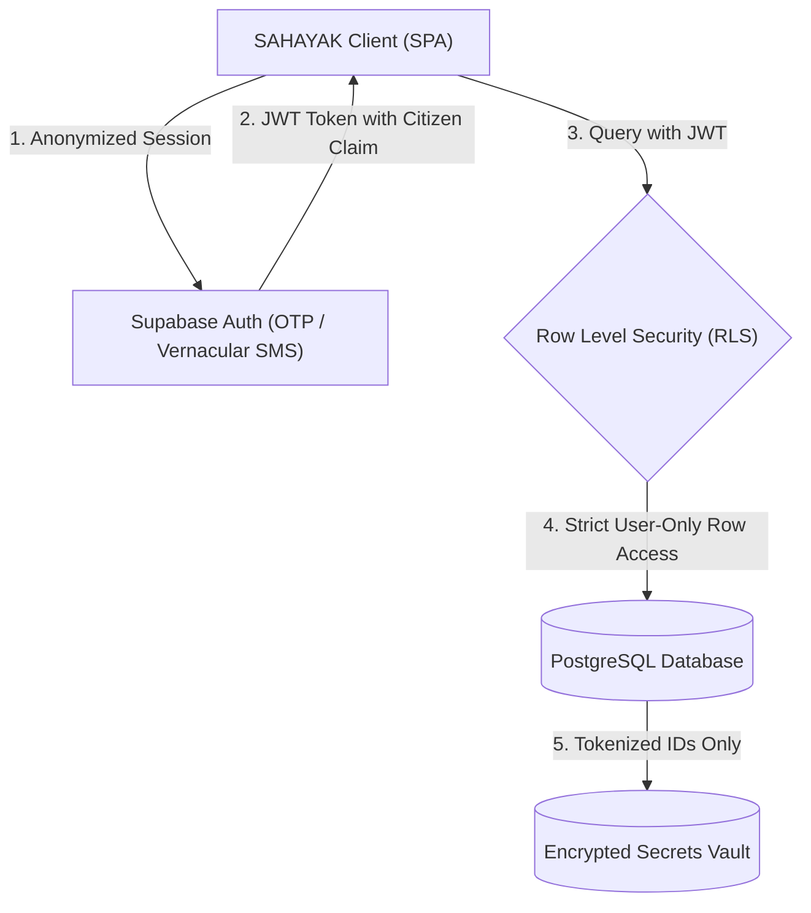

# SAHAYAK — Security Readiness & Data Privacy Report
**Phase:** 4.4 — Codebase Audit, Build Stabilization & Technical Readiness  
**Product:** SAHAYAK (PIXEL THEORY)  
**Track:** DS-02: Government Schemes in Your Language  
**Date:** November 2026  
**Auditor:** Principal Software Architect & Security Specialist  

---

## 1. Security Philosophy & Bharat Data Governance

As a sovereign citizen welfare information platform, SAHAYAK must uphold rigorous data privacy standards. The application handles citizen welfare assessments, household demographic profiles, and simulated document verifications.

---

## 2. Client-Side Storage Audit

### 2.1 Prohibition of Raw PII in Local Storage
- **Audit Rule:** No raw 12-digit Aadhaar numbers, unmasked bank account numbers, IFSC codes, PAN numbers, or sensitive identity tokens may ever be written to unencrypted `localStorage`, `sessionStorage`, or IndexedDB.
- **Current State:**
  - All mock user profiles in `src/store/useAppStore.ts` store only high-level eligibility attributes (age, occupation, state, landholding in acres, annual income range, and boolean flags `isAadhaarLinkedBank`, `isDigiLockerLinked`).
  - No 12-digit Aadhaar strings or bank account credentials are stored in cleartext.
  - Automated tests (`src/test/securityAndPrivacy.test.ts`) enforce this invariant programmatically.

### 2.2 Session Boundary
- In the current demonstration phase, state is held in-memory via Zustand.
- Even upon refresh, temporary assessment inputs do not persist raw biometric or personal identification tokens to disk.

---

## 3. Preliminary Guidance vs. Official Approval

### 3.1 Trust Architecture & Regulatory Compliance
- The client-side eligibility engine (`eligibilityEngine.ts`) provides **preliminary discovery guidance**, not statutory legal entitlement.
- Every assessment output carries an explicit disclaimer:
  - `disclaimer_not_assessed`: Directs the user to complete assessment questions.
  - `disclaimer_in_progress`: Informs the citizen that partial answers cannot establish eligibility.
  - `disclaimer_preliminary_guidance`: Explicitly states that final approval is subject to official document verification by the competent government authority (Tahsildar, CDPO, or District Welfare Officer).

---

## 4. Document Handling & Verification Safeguards

1. **Simulated Document Ingestion:**
   - The document checklist screen (`DocumentChecklistScreen.tsx`) simulates DigiLocker instant verification and local photo capture.
   - In the mock environment, no actual citizen identity files or biometrics are transmitted to third-party endpoints.
2. **Statutory Fee Transparency (Anti-Intermediary Protection):**
   - The CSC summary slip (`CscSlipScreen.tsx`) displays the official statutory application fee (`₹0.00`) alongside the statutory order citation (e.g., Order No. 1-1/2019-Credit-I).
   - This design directly safeguards rural and semi-literate citizens against predatory fee inflation by unauthorized local middlemen.

---

## 5. Future Supabase Integration Security Blueprint (Phase 5)

When Supabase backend authentication and storage are connected in subsequent phases, the following controls are mandatory:

### Key Security Requirements for Phase 5:
1. **Row Level Security (RLS):**
   - Enable RLS on every table (`profiles`, `applications`, `document_metadata`).
   - Policies must guarantee that a citizen can only `SELECT` and `UPDATE` records where `auth.uid() = user_id`.
2. **Encrypted Tokenization:**
   - Any government identifier required for real portal tracking (e.g., application token or DigiLocker transaction reference) must be encrypted via pgcrypto or stored in a secure server-side vault.
3. **No Direct Secret Exposure:**
   - Supabase `service_role` keys must never be bundled into the Vite client distribution. Only the public `anon` key with RLS enforcement may be exposed.
