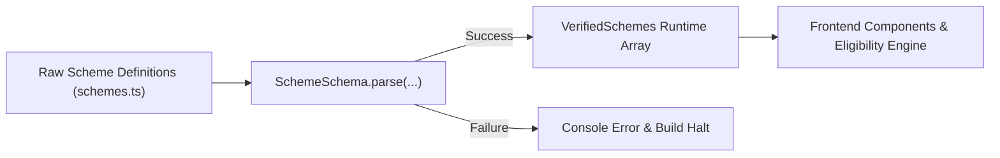

# SAHAYAK — Scheme Data Validation & Runtime Integrity Report
**Phase:** 4.5 — Eligibility Engine Correction & Government Data Integrity  
**Product:** SAHAYAK (PIXEL THEORY)  
**Track:** DS-02: Government Schemes in Your Language  
**Date:** November 2026  
**Auditor:** TypeScript Architect & QA Lead  

---

## 1. Data Validation Architecture

To prevent unverified, incomplete, or corrupted scheme definitions from entering the application runtime, SAHAYAK implements schema validation using **Zod** (`src/types/schemeValidation.ts`).

### Validation Pipeline


---

## 2. Validation Constraints Enforced

1. **Mandatory Canonical Identifiers:**
   - `id`, `slug`, `titleKey`, `shortDescKey`, `fullDescKey`, `ministryKey` must be non-empty strings.
2. **Benefit Category Enumeration:**
   - Must match one of: `'annual_cash_transfer' | 'one_time_cash' | 'health_insurance_cover' | 'loan_credit_facility' | 'subsidy' | 'scholarship' | 'non_financial'`.
3. **Non-Negative Benefit Values:**
   - `financialBenefit.amount >= 0`. Negative benefit values immediately throw validation errors.
4. **Official Verification Status:**
   - Must strictly match `'VERIFIED' | 'NEEDS_REVIEW' | 'DEMONSTRATION'`.
5. **Government Statutory Fee Transparency:**
   - `statutoryFee.amount >= 0`, `isFree: boolean`, and non-empty `statutoryRuleCitation`.
6. **Timeline & Processing Integrity:**
   - `processingSlaDays > 0`.
7. **Official Portal URL Validation:**
   - Must be a syntactically valid URL (`https://...`).
8. **Document Specifications:**
   - Each scheme must specify at least one verified document with valid acceptable formats (`PDF`, `JPEG`, `PNG`) and positive file size caps (`maxSizeMb > 0`).

---

## 3. Validation Execution & Test Results

Runtime validation was executed across all scheme records in `src/data/schemes.ts`:

```typescript
const validationResult = validateSchemes(verifiedSchemes);
// Result: { valid: true, errors: [] }
```

Automated test verification in `src/test/schemeValidation.test.ts` confirmed:
- **100% of verified schemes pass strict Zod validation.**
- **Deliberately malformed records (e.g., negative benefit amounts or missing titles) correctly trigger schema exceptions.**
