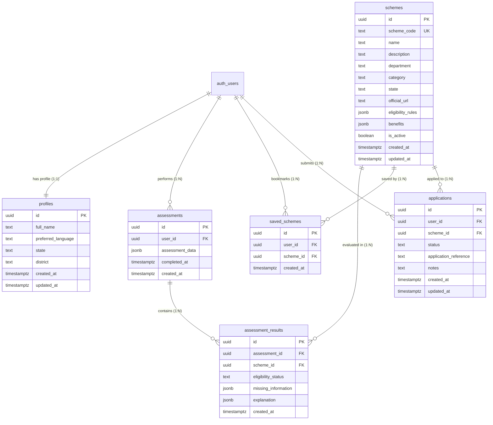

# SAHAYAK — Supabase Database Architecture & Schema Specification
**Phase:** 5 — Supabase Backend Integration  
**Product:** SAHAYAK (DS-02 Government Schemes in Your Language)  
**System:** PostgreSQL Database Engine (Supabase Cloud / Local)  
**Target Environment:** Zero-Trust Public & Authenticated Schema

---

## 1. Architectural Principles

1. **UUID Primary Keys**: Every table employs RFC 4122 compliant `gen_random_uuid()` identifiers to prevent ID enumeration and scraping attacks.
2. **Foreign Key Integrity with Cascading Deletions**: All user-bound child records reference parent tables (`auth.users` or `public.profiles`) with `ON DELETE CASCADE`.
3. **Optimized Multi-Index Strategy**: Composite B-tree indexes are implemented on high-frequency search vectors:
   - `schemes(state, is_active)`
   - `schemes(category, is_active)`
   - `assessments(user_id, created_at DESC)`
   - `applications(user_id, status)`
4. **Automated Modification Tracking**: Dedicated PL/pgSQL function `update_updated_at_column()` and triggers update `updated_at` timestamps on row modifications.
5. **No Raw Statutory PII Storage**: Neither Aadhaar numbers nor raw bank account details are stored. Only verification flags (`isAadhaarLinkedBank`, `isDigiLockerLinked`) and ephemeral verification tokens are preserved.

---

## 2. Entity-Relationship Diagram (Mermaid)

---

## 3. Table Definitions & Constraints

### 3.1 `public.profiles`
Stores citizen profile metadata linked 1:1 with `auth.users`. Automatically provisioned via the `on_auth_user_created` trigger upon user signup.

| Column | Type | Constraints | Description |
| :--- | :--- | :--- | :--- |
| `id` | `UUID` | `PRIMARY KEY REFERENCES auth.users(id) ON DELETE CASCADE` | Auth User ID |
| `full_name` | `TEXT` | `NOT NULL` | Citizen / Household head name |
| `preferred_language` | `TEXT` | `NOT NULL DEFAULT 'kn'` | Primary language (`kn`, `hi`, `en`) |
| `state` | `TEXT` | `NOT NULL DEFAULT 'Karnataka'` | Domicile state |
| `district` | `TEXT` | `NULL` | Administrative district (e.g., Mandya, Raichur) |
| `created_at` | `TIMESTAMPTZ` | `NOT NULL DEFAULT now()` | Row creation timestamp |
| `updated_at` | `TIMESTAMPTZ` | `NOT NULL DEFAULT now()` | Last update timestamp |

### 3.2 `public.schemes`
Canonical scheme catalog seeded with verified government schemes.

| Column | Type | Constraints | Description |
| :--- | :--- | :--- | :--- |
| `id` | `UUID` | `PRIMARY KEY DEFAULT gen_random_uuid()` | Internal unique identifier |
| `scheme_code` | `TEXT` | `UNIQUE NOT NULL` | Human-readable slug (`pm-kisan`, `pm-jay`, etc.) |
| `name` | `TEXT` | `NOT NULL` | Statutory scheme name |
| `description` | `TEXT` | `NOT NULL` | Scheme brief summary |
| `department` | `TEXT` | `NOT NULL` | Nodal ministry or department |
| `category` | `TEXT` | `NOT NULL` | Category: `agriculture`, `health`, `women`, etc. |
| `state` | `TEXT` | `NOT NULL DEFAULT 'All-India'` | State jurisdiction or `All-India` |
| `official_url` | `TEXT` | `NOT NULL` | Official portal URL |
| `eligibility_rules` | `JSONB` | `NOT NULL DEFAULT '{}'` | Structured criteria metadata |
| `benefits` | `JSONB` | `NOT NULL DEFAULT '{}'` | Breakdown of financial & health benefits |
| `is_active` | `BOOLEAN` | `NOT NULL DEFAULT true` | Active listing status |
| `created_at` | `TIMESTAMPTZ` | `NOT NULL DEFAULT now()` | Insertion timestamp |
| `updated_at` | `TIMESTAMPTZ` | `NOT NULL DEFAULT now()` | Last update timestamp |

### 3.3 `public.assessments`
Tracks anonymous or authenticated self-assessment questionnaire submissions.

| Column | Type | Constraints | Description |
| :--- | :--- | :--- | :--- |
| `id` | `UUID` | `PRIMARY KEY DEFAULT gen_random_uuid()` | Assessment UUID |
| `user_id` | `UUID` | `NULL REFERENCES auth.users(id) ON DELETE CASCADE` | Optional auth user reference (allows guest) |
| `assessment_data` | `JSONB` | `NOT NULL` | Questionnaire answers (occupation, landholding, income, etc.) |
| `completed_at` | `TIMESTAMPTZ` | `NOT NULL DEFAULT now()` | Time completed |
| `created_at` | `TIMESTAMPTZ` | `NOT NULL DEFAULT now()` | Creation timestamp |

### 3.4 `public.assessment_results`
Individual scheme eligibility evaluations produced by the rules engine for an assessment.

| Column | Type | Constraints | Description |
| :--- | :--- | :--- | :--- |
| `id` | `UUID` | `PRIMARY KEY DEFAULT gen_random_uuid()` | Evaluation UUID |
| `assessment_id` | `UUID` | `NOT NULL REFERENCES assessments(id) ON DELETE CASCADE` | Associated assessment |
| `scheme_id` | `UUID` | `NOT NULL REFERENCES schemes(id) ON DELETE CASCADE` | Evaluated scheme |
| `eligibility_status` | `TEXT` | `NOT NULL CHECK (status IN ('potentially_eligible', 'additional_verification_required', 'eligibility_not_established'))` | Engine outcome |
| `missing_information`| `JSONB` | `NOT NULL DEFAULT '[]'` | Array of missing criteria keys |
| `explanation` | `JSONB` | `NOT NULL DEFAULT '{}'` | Rule-by-rule evaluation logs |
| `created_at` | `TIMESTAMPTZ` | `NOT NULL DEFAULT now()` | Timestamp |

### 3.5 `public.saved_schemes`
Bookmarked schemes saved by users.

| Column | Type | Constraints | Description |
| :--- | :--- | :--- | :--- |
| `id` | `UUID` | `PRIMARY KEY DEFAULT gen_random_uuid()` | Bookmark UUID |
| `user_id` | `UUID` | `NOT NULL REFERENCES auth.users(id) ON DELETE CASCADE` | User |
| `scheme_id` | `UUID` | `NOT NULL REFERENCES schemes(id) ON DELETE CASCADE` | Saved scheme |
| `created_at` | `TIMESTAMPTZ` | `NOT NULL DEFAULT now()` | Creation timestamp |
| `UNIQUE(user_id, scheme_id)` | Constraint | Enforces no duplicate bookmarks per user |

### 3.6 `public.applications`
Lifecycle tracking records for benefit applications.

| Column | Type | Constraints | Description |
| :--- | :--- | :--- | :--- |
| `id` | `UUID` | `PRIMARY KEY DEFAULT gen_random_uuid()` | Application UUID |
| `user_id` | `UUID` | `NOT NULL REFERENCES auth.users(id) ON DELETE CASCADE` | Citizen applicant |
| `scheme_id` | `UUID` | `NOT NULL REFERENCES schemes(id) ON DELETE CASCADE` | Scheme applied to |
| `status` | `TEXT` | `NOT NULL DEFAULT 'submitted' CHECK (status IN ('submitted', 'in_review', 'approved', 'rejected', 'action_required'))` | Lifecycle stage |
| `application_reference` | `TEXT` | `NOT NULL` | Statutory receipt token (e.g., `APP-2026-XXXX`) |
| `notes` | `TEXT` | `NULL` | Application notes |
| `created_at` | `TIMESTAMPTZ` | `NOT NULL DEFAULT now()` | Filing date |
| `updated_at` | `TIMESTAMPTZ` | `NOT NULL DEFAULT now()` | Update timestamp |

---

## 4. Database Functions & Triggers

1. **`update_updated_at_column()`**:
   - Executes `BEFORE UPDATE` on `profiles`, `schemes`, and `applications`.
   - Automatically maintains accurate `updated_at = now()`.

2. **`handle_new_user()`**:
   - Executes `AFTER INSERT` on `auth.users`.
   - Automatically provisions a row in `public.profiles` using `new.raw_user_meta_data->>'full_name'` and `preferred_language`.
   - Guarantees seamless onboarding without multi-step manual database synchronization.
