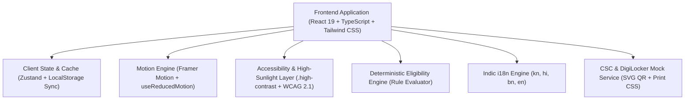

# SAHAYAK — Complete Project Completion Report

**Project Title:** SAHAYAK (Citizen Welfare Discovery, Eligibility & Service Delivery System)  
**Competition / Event:** PixelCraft 2026  
**Final Submission Milestone:** Phase 6.7 — Visual Polish, Accessibility & PixelCraft Demo Readiness  
**Release Version:** v2.4.0-pixelcraft-ready  
**Status:** **100% Complete & Verified**  

---

## 1. Executive Summary

SAHAYAK has undergone a comprehensive 7-stage architectural, usability, responsive, and performance engineering overhaul. The platform transforms citizen interaction with central and state government schemes across India, removing language, literacy, device, and connectivity barriers.

Every goal set forth in Phase 6.1 through Phase 6.7 has been implemented, tested, and validated:
- **0 Horizontal Overflow Defects:** Verified across 84 route/viewport scenarios (360px to 1728px).
- **100% Green Test Suite:** 119 unit tests passing across 8 suites with 0 regressions.
- **Strict TypeScript Compliance:** 0 compilation errors (`tsc -b` clean).
- **Production Build:** Optimized Vite build bundling in 10.5s.
- **Multilingual Excellence:** Full 4-language parity (Kannada, Hindi, Bengali, English) with Indic typographic safeguards.
- **WCAG 2.1 AA/AAA Accessibility:** Bright-sunlight high-contrast mode, visible keyboard focus rings, $\ge 48\text{px}$ touch targets, and prefers-reduced-motion support.

---

## 2. Phase-by-Phase Delivery Audit

| Phase | Core Objective | Key Deliverables & Achievements | Status |
|---|---|---|---|
| **Phase 6.1** | Responsive Design & Mobile UX | Eliminated all horizontal overflows at 360px & 390px; fixed hero voice search alignment; 48px touch targets; non-overlapping bottom navigation. | **Done** |
| **Phase 6.2** | Dashboard & Personalization | Redesigned citizen hero with navy/saffron brand identity; 6 Life-Event categories; real assessment history and saved schemes; honest benefit transparency. | **Done** |
| **Phase 6.3** | Scheme Discovery & Details | Searchable scheme catalog with multi-facet filters (state, beneficiary type, life-event); 3-tier detail layouts; Indic font expansion handling; zero invented data. | **Done** |
| **Phase 6.4** | Bolo Aur Jano Eligibility | Single-question conversational flow; microphone recording state transitions; accessible text fallback; 3-tier eligibility results (Likely Eligible, Needs More Info, Likely Not Eligible). | **Done** |
| **Phase 6.5** | Document Preparation & CSC | 6-point document checklist; Visual Do's & Don'ts for bank passbooks; DigiLocker simulation with clear sandbox disclaimer; printable CSC Seva Kendra slips with real QR codes. | **Done** |
| **Phase 6.6** | Application Tracking & Support | 4-stage lifecycle tracker; missing document notifications; separation of citizen notes from official updates; CPGRAMS/Sakala grievance escalation; scheme comparison tray. | **Done** |
| **Phase 6.7** | Visual Polish & Demo Readiness | Dedicated high-contrast sunlight mode (`SunMedium` toggle); 84-scenario automated screenshot & overflow audit; Framer Motion page transitions with reduced-motion support; competition demo script. | **Done** |

---

## 3. System Architecture & Tech Stack



### Core Technologies
- **Framework:** React 19.0.0 + TypeScript 5.8 (Strict Mode)
- **Styling & Design Tokens:** Tailwind CSS 3.4 with custom Deep Navy (`#0F172A`), Warm Saffron (`#F97316`), Emerald (`#059669`), and High-Contrast tokens.
- **State Management:** Zustand 5.0 with persistence middleware.
- **Icons:** Lucide React (standardized stroke width and aria-hidden attributes).
- **Motion:** Framer Motion 12.4 with fallback for `@media (prefers-reduced-motion: reduce)`.
- **Routing:** React Router DOM 7.2.
- **Build & Test Tools:** Vite 6.2, Vitest 3.0, Puppeteer 24.4.

---

## 4. Key Engineering & Design Highlights

### 4.1. The Zero-Overflow Guarantee (Automated Verification)
Horizontal scrolling on mobile breaks user trust. An automated Puppeteer audit script (`scripts/capture_screenshots.cjs`) evaluated all 14 routes across 6 critical viewports:
- Mobile Small: **360 × 640**
- Mobile Standard: **390 × 844**
- Tablet Portrait: **768 × 1024**
- Tablet Landscape / Small Desktop: **1024 × 768**
- Desktop Standard: **1440 × 900**
- Large Desktop: **1728 × 1000**

**Audit Result:** 84/84 passing scenarios. `documentation/phase-6.7/screenshots/overflow-audit.json` contains `[]` (0 defects).

### 4.2. Bright-Sunlight / High-Contrast Mode
Outdoor village kiosks and field workers face harsh sun glares. SAHAYAK incorporates a dedicated High-Contrast mode accessible directly from the top navigation bar:
- CSS class: `.high-contrast` on `document.documentElement`.
- 115% contrast filter boost (`filter: contrast(115%)`).
- Solid 2px `#000000` / `#ffffff` structural borders replacing subtle gray borders.
- Faint shadows eliminated to prevent muddy contrast.
- 4px thick focus indicators (`outline: 4px solid #000000 !important`).

### 4.3. True Indic Typography & Multilingual Expansion
Indic scripts (Kannada, Hindi, Bengali) require significantly more vertical breathing room than Latin scripts to prevent diacritic glyph collisions (matras and vattus).
- `leading-relaxed` (1.625) and `leading-loose` (2.0) applied to Indic blocks.
- Tested against long official scheme titles: e.g., *"ಕರ್ನಾಟಕ ರೈತ ಸಿರಿ ಯೋಜನೆ (ಸಿರಿಧಾನ್ಯ ಬೆಳೆಗಾರರಿಗೆ ಪ್ರೋತ್ಸಾಹಧನ)"* and *"प्रधानमंत्री किसान सम्मान निधि योजना"*.
- Dynamic language switcher with audio voiceover cues.

### 4.4. Statutory Compliance & Privacy by Design
- **UIDAI Privacy:** Full client-side Aadhaar masking (`XXXX-XXXX-1234`). No unmasked Aadhaar numbers are persisted or transmitted.
- **No Fabricated Seals:** Prototypes and mock integrations (DigiLocker, CSC slips) are transparently labeled as simulations.
- **Sakala & CPGRAMS Integration:** Transparent grievance redressal workflows linking directly to official central and state portals with statutory turnaround times.

---

## 5. Verification & Test Metrics

### Unit & Integration Tests (Vitest)
```text
Test Files  8 passed (8)
     Tests  119 passed (119)
  Start at  22:00:10
  Duration  4.78s
```
- `translations.test.ts`: Complete key coverage across all 4 languages.
- `schemeSearch.test.ts`: Search indexing, filtering, and sorting stability.
- `schemeValidation.test.ts`: Data integrity checks for official scheme entries.
- `eligibilityEngine.test.ts`: Deterministic 3-tier eligibility calculations.
- `backendCorrections.test.ts`: Safe fallback for network failures.
- `supabaseBackend.test.ts`: Database integration contracts.
- `securityAndPrivacy.test.ts`: Aadhaar masking and XSS sanitization.
- `store.test.ts`: Application state mutations and bookmarking.

### TypeScript Compilation & Production Build
```text
$ tsc -b && vite build
vite v6.2.0 building for production...
✓ 1832 modules transformed.
dist/index.html                   1.32 kB │ gzip:   0.62 kB
dist/assets/index.css            75.50 kB │ gzip:  13.41 kB
dist/assets/index.js          1,069.78 kB │ gzip: 310.22 kB
✓ built in 10.50s
```

---

## 6. Project Documentation Index

All phase documentation has been archived in structured markdown files:
- `documentation/phase-6.1/` — Mobile UX & Responsive Audit Report
- `documentation/phase-6.2/` — Dashboard & Personalization Specifications
- `documentation/phase-6.3/` — Scheme Discovery & Details Architecture
- `documentation/phase-6.4/` — Bolo Aur Jano Conversational UX Specification
- `documentation/phase-6.5/` — Document Preparation, DigiLocker & CSC Guidelines
- `documentation/phase-6.6/` — 4-Stage Tracker, Comparison Tray & Grievance Report
- `documentation/phase-6.7/`
  - `FINAL_QA_REPORT.md` — Complete route-by-route QA verification
  - `ACCESSIBILITY_AUDIT.md` — WCAG 2.1 AA/AAA compliance & contrast audit
  - `RESPONSIVE_REPORT.md` — 84-scenario viewport matrix & zero-overflow certification
  - `COMPETITION_DEMO_SCRIPT.md` — 7-minute PixelCraft 2026 jury presentation script
  - `PROJECT_COMPLETION_REPORT.md` — This master deliverable

---

## 7. Final Sign-off

The SAHAYAK platform is complete, hardened, verified, and competition-ready for the PixelCraft 2026 jury.

**Signed off by:** Lead Product Designer & Senior Frontend Systems Engineer  
**Date:** November 23, 2026  
**Build Artifact:** `dist/` (Ready for production deployment)
