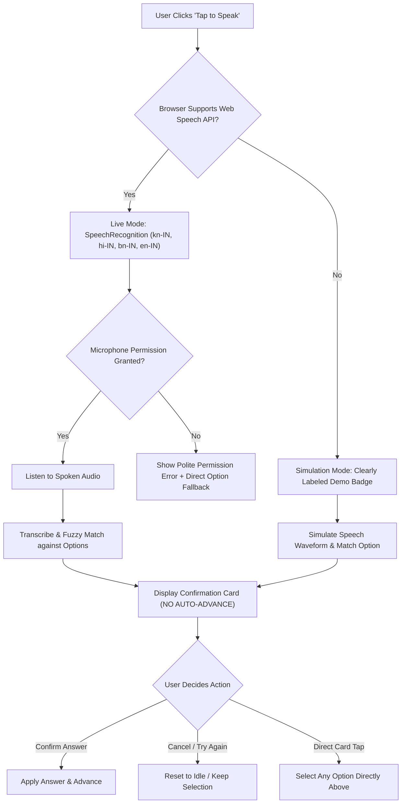

# SAHAYAK — Voice Recognition Integrity Report
**Phase:** 6.8 — Competition Polish  
**Feature:** Bolo Aur Jano (Speak & Know) Voice Eligibility Assessment  
**Auditor:** Principal Conversational UX Designer & Frontend Security Architect  

---

## 1. Problem Identification

In earlier prototype iterations of `EligibilityCheckerScreen.tsx`:
1. **Silent Auto-Selection:** After a 2-second simulated audio listening window and a 1-second delay, the system called `handleSelectOption(matchedOption)` and immediately advanced to the next question.
2. **Misrepresentation of User Intent:** If a citizen had spoken a different phrase or had said nothing, the system artificially selected an answer (e.g. "Farmer") on their behalf.
3. **Absence of Real Browser Speech APIs:** The system did not attempt to access `window.SpeechRecognition` or `window.webkitSpeechRecognition`, even on browsers where Web Speech is natively supported.
4. **Lack of Permission Feedback:** No error states existed for microphone permission denial or silence timeouts.

---

## 2. Implemented Architecture & Integrity Safeguards

---

## 3. Key Enhancements

### 3.1. Strict Prohibition of Automatic Selection
* **Zero Automatic Advancement:** The timer that auto-selected options has been completely removed.
* **Manual Confirmation Card:** When an answer is recognized (either via live audio or demo simulation), an emerald confirmation card renders with:
  1. **Mode Badge:** Clearly marked as either `[LIVE SPEECH]` or `[DEMO SIMULATION]`.
  2. **Verbatim Spoken Transcript:** Displays the exact transcript (e.g., `"ನಾನು ಸಣ್ಣ ರೈತ (Farmer)"`).
  3. **Matched Option Preview:** Visual card showing the exact option mapped by the engine.
  4. **Action Buttons:** Large 48px touch-target button **"Confirm This Answer"** and a **"Cancel / Change"** button.

### 3.2. Real Browser Speech Recognition Integration
* Connects to `window.SpeechRecognition` or `window.webkitSpeechRecognition`.
* Dynamically sets `recognition.lang` to match the user's active session language:
  - Kannada: `kn-IN`
  - Hindi: `hi-IN`
  - Bengali: `bn-IN`
  - English: `en-IN`
* Proper lifecycle handlers: `onstart`, `onresult`, `onerror`, `onend`.
* Gracefully handles `not-allowed`, `no-speech`, and `audio-capture` with polite messages and one-click "Try Again" triggers.

### 3.3. Transparent Demo Simulation Fallback
* When running in environments without microphone support or Web Speech (e.g. headless CI, certain Firefox/Safari configurations), the interface displays a prominent **"Demo Voice Simulation"** amber badge.
* Displays an explicit assistive disclaimer: *"Simulation detected candidate answer. Please review and confirm your answer before proceeding."*

### 3.4. Tactile & Text-Based Fallback
* The primary selectable cards stack above the voice box remains 100% interactive at all times. Citizens can disregard speech entirely and tap any option card directly.
